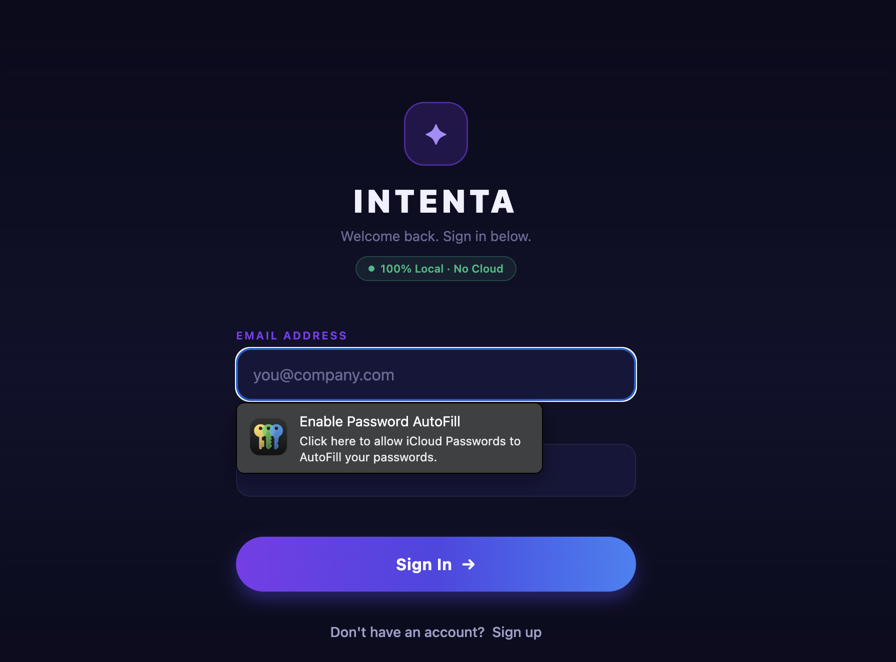
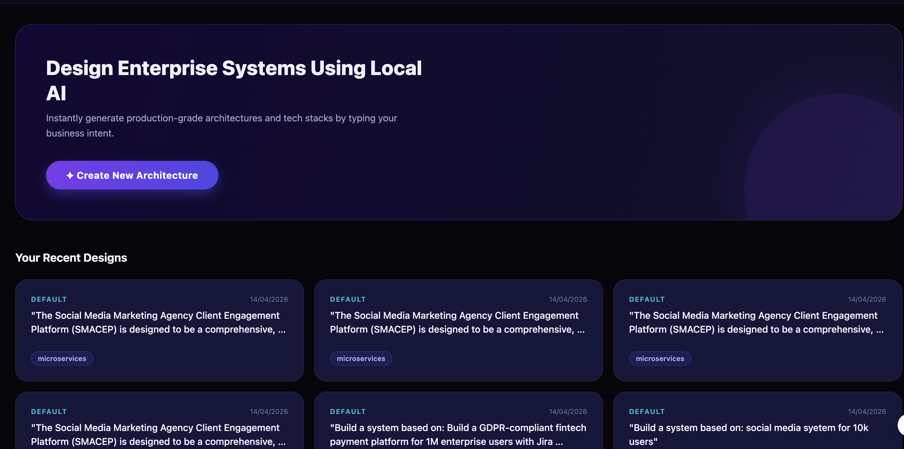
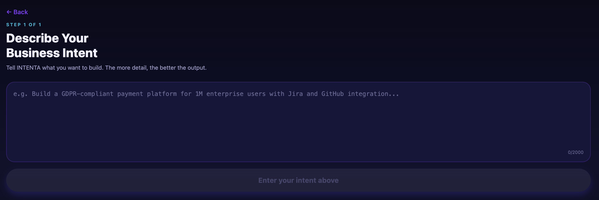

# INTENTA — AI-Native Intent-Centric Software Development System

# From Intent to System — Fully Local, Fully Autonomous


## 📱 UI Preview

<p align="center">
  
  
  
</p>


## Overview

INTENTA transforms a plain-English business intent into a **complete enterprise system design** in seconds, powered entirely by local AI (Mistral 7B via Ollama). No cloud. No API keys. 100% offline.

```
User Intent (text)
      ↓
INTENTA SuperAgent (local)
      ↓
Local LLM + Rule Engine + Templates
      ↓
Enterprise System Design Output
```

---

## Architecture

| Layer | Technology |
|---|---|
| Frontend (mobile) | React Native + Expo |
| Backend API | FastAPI (Python async) |
| AI / LLM | Ollama running Mistral 7B (local Docker) |
| Database | MongoDB (Motor async) |
| Deployment | Docker + Docker Compose |

## SuperAgent Modules

| Module | Role |
|---|---|
| Intent Parser | LLM extracts goal, scale, domain, compliance, integrations |
| Architecture Generator | Rules + LLM → monolith / microservices / event-driven |
| Tech Stack Selector | Deterministic stack by scale + domain |
| Code Blueprint | LLM generates service specs, endpoints, folder structure |
| Validation Engine | LLM generates testing strategy |
| Compliance Engine | Deterministic GDPR / SOC2 / HIPAA / PCI-DSS mapping |
| Governance Engine | RBAC roles + approval workflows |
| Explainability Engine | LLM justifies all decisions with risk levels |

---

## Quick Start

### 1. Full stack via Docker Compose

```bash
# Build and start all services
docker-compose up --build

# On first run, Ollama auto-pulls Mistral (this takes 5-15 min)
# Monitor: docker logs intenta-ollama-init -f
```

Services:
- Backend API: http://localhost:8000
- API Docs: http://localhost:8000/docs
- MongoDB: mongodb://localhost:27017
- Ollama: http://localhost:11434

### 2. Backend only (local development)

```bash
cd backend

# Create venv and install deps
python -m venv venv
source venv/bin/activate
pip install -r requirements.txt

# Start Ollama separately (requires Ollama installed)
ollama pull mistral
ollama serve

# Set env vars
export OLLAMA_BASE_URL=http://localhost:11434
export MONGODB_URL=mongodb://localhost:27017

# Run
uvicorn app.main:app --reload --host 0.0.0.0 --port 8000
```

### 3. Frontend (React Native / Expo)

```bash
cd frontend

# Install Node.js 20+ first if needed
npm install
npx expo start
```

Scan QR code with Expo Go app on your phone, or press `w` for web preview.

---

## API Reference

### POST /generate

**Request:**
```json
{
  "input": "Build a GDPR-compliant fintech payment platform for 1M enterprise users"
}
```

**Response:** (8 sections)
```json
{
  "session_id": "uuid",
  "intent": { "goal": "...", "scale": "high", "domain": "fintech", ... },
  "architecture": { "pattern": "event-driven-microservices", "services": [...], ... },
  "tech_stack": { "frontend": [...], "backend": [...], "database": [...], ... },
  "code_blueprint": { "services": [...], "folder_structure": {...}, ... },
  "validation": { "unit_tests": [...], "recommended_tools": [...], ... },
  "compliance": { "applicable_regulations": ["GDPR","SOC2","PCI_DSS"], "rules": [...], ... },
  "governance": { "rbac_roles": [...], "approval_workflows": [...], ... },
  "explainability": { "decisions": [...], "confidence_score": 0.92, ... },
  "processing_time_ms": 8432.1
}
```

### GET /health
```json
{ "status": "healthy", "llm_available": true, "model": "mistral" }
```

---

## Hybrid Intelligence Design

```
User Input
    ↓
[LLM] Intent Parser → structured fields
    ↓
[Rules] Architecture Rules → pattern (scale + domain → deterministic)
    ↓
[LLM] Architecture Rationale → enriched explanation
    ↓
[Rules] Tech Stack Selector → stack (pattern + domain → deterministic)
    ↓
[LLM] Code Blueprint, Validation, Explainability → creative structured output
    ↓
[Rules] Compliance Engine → regulations, controls, encryption, audit events (deterministic)
    ↓
[Rules] Governance Engine → RBAC, workflows, policies (deterministic)
    ↓
MongoDB Storage + Mock Integrations (Jira, GitHub, SAP, ServiceNow)
```

**Rule Engine guarantees correctness. LLM adds intelligence.**

---

## Testing

```bash
cd backend
source venv/bin/activate
pytest tests/ -v
```

### Test Coverage
- `tests/test_agent.py` — Unit tests for all 8 agent modules (mocked LLM)
- `tests/test_api.py` — FastAPI endpoint tests
- `tests/test_integration.py` — Full pipeline integration tests

---

## Environment Variables

| Variable | Default | Description |
|---|---|---|
| `OLLAMA_BASE_URL` | `http://ollama:11434` | Ollama server URL |
| `OLLAMA_MODEL` | `mistral` | LLM model name |
| `OLLAMA_TIMEOUT` | `180` | LLM request timeout (seconds) |
| `MONGODB_URL` | `mongodb://mongodb:27017` | MongoDB connection |
| `MONGODB_DB_NAME` | `intenta` | Database name |
| `LOG_LEVEL` | `INFO` | Logging level |
| `LOG_FORMAT` | `json` | `json` or `console` |

---

## Compliance Coverage

| Regulation | Domains | Controls |
|---|---|---|
| GDPR | All | Data Subject Rights, Consent, Minimization, Portability, Breach Notification |
| SOC2 | SaaS, Fintech | Access Control, Audit Logs, Encryption, Vulnerability Management |
| HIPAA | Healthcare | PHI Encryption, Access Controls, BAA, Audit Controls |
| PCI-DSS | Fintech, E-commerce | Tokenization, Network Segmentation, Pen Testing, TLS |

---

## Mock Integrations

| Integration | Simulates |
|---|---|
| Jira | Epic creation, sprint story generation |
| GitHub | Repository creation, branch protection, CI workflows |
| SAP | S/4HANA project registration, cost centre, WBS |
| ServiceNow | ITSM change request, CMDB CI registration |

---

## Kubernetes-Ready Structure

The `infra/k8s/` directories in the generated blueprints follow standard K8s conventions:
- Deployments per service
- Services + Ingress
- ConfigMaps for environment config
- HPA for auto-scaling

Deploy with Helm charts or `kubectl apply -f infra/k8s/`.

📄 License

MIT License
:::

⸻

